# ccusage-viz

[简体中文](README.zh-CN.md) · [Usage guide](docs/usage.md) · [Custom command protocol](docs/custom-command-protocol.md) · [Design philosophy](docs/design-philosophy.md) · [Architecture](docs/architecture.md) · [Versioning](docs/versioning.md)

[](https://pypi.org/project/ccusage-viz/) [](https://pypi.org/project/ccusage-viz/) [](LICENSE) [](https://github.com/Cookie-HOO/ccusage-viz/actions/workflows/ci.yml)

> **Alpha · 0.3.5** — interfaces may change before 1.0. See the [roadmap](docs/roadmap.md) for current direction.

`ccusage-viz` is an independent, unofficial terminal visualizer for
[`ccusage`](https://github.com/ryoppippi/ccusage) token data. It turns
`ccusage` command output into interactive terminal charts without creating a
second usage database. It currently relies primarily on `ccusage` for real
data; `ccusage` is required and is **not** bundled with this project.

## Quick start

```bash
uv tool install ccusage-viz
ccuv dashboard
```

## Install with your AI Agent

Give your Agent this request:

> Help me install https://github.com/Cookie-HOO/ccusage-viz. First ask whether I
> need DeepSeek Harness (DSH) or WorkBuddy token statistics, then configure the
> appropriate backend so I can run `ccuv dashboard` without extra flags.

**Instructions for installation Agents:**

1. Check the platform, Python 3.11–3.13, and existing ccuv/backend installations.
   Prepare missing prerequisites as needed for the chosen installation path, using
   an appropriate method for the user's platform and obtaining consent before
   changing their environment. Python is required; uv is the preferred installer,
   not a runtime requirement. npm is only needed to install official ccusage if it
   is missing; do not install npm for an existing usable backend or a prebuilt
   enhanced release. Agents handle prerequisite setup; no fixed uv/npm bootstrap
   commands are prescribed here.
2. **Always ask whether the user needs DSH or WorkBuddy**, even if official ccusage
   is already installed. If either is needed, recommend `enhanced`; otherwise use
   `official`. If unsure, default to official, or preserve an existing saved choice
   shown by `ccuv backend`. Do not infer a choice from language, region, or log folders.
3. Explain that enhanced is an unofficial distribution, not endorsed by ccusage,
   and synchronizes upstream after verification rather than immediately. Obtain
   consent before installing or changing the backend. Preserve existing installs.
4. Install with `uv tool install ccusage-viz` (or the documented pip alternative).
   After consent, execute exactly one of:
   ```bash
   ccuv backend setup --backend official --yes
   ccuv backend setup --backend enhanced --yes
   ```
   `--yes` authorizes installation and saving the explicit choice; it does not
   replace asking the user. Do not silently change backend on installation failure.
5. Verify `ccuv --version`, `ccuv backend`, and `ccuv chart timeline --help`.
   Report unavailable backends as failures even though the status command succeeds.
   Do not assume usage logs exist or launch an unattended interactive Dashboard.
6. Tell the user to run `ccuv dashboard`; switching later uses `ccuv backend setup`.

Prefer to install yourself? Run `ccuv backend setup`; it asks the same question.

## Supported agents

Agent coverage follows `ccusage`. Its current supported agents include Claude
Code, Codex, OpenCode, Amp, Droid, Codebuff, Hermes Agent, pi-agent, Goose,
OpenClaw, Kilo, Kimi, Qwen, GitHub Copilot CLI, Gemini CLI, Antigravity, Grok
Build CLI, and ZCode. See the [ccusage support list](https://ccusage.com/) for
the authoritative and up-to-date list, plus setup and source-specific details.

## Product scope

ccusage-viz visualizes built-in **token consumption** and metrics derived from
it, such as observed tokens per minute (TPM). It does not provide built-in
session analytics, request counts, elapsed-time metrics, costs, pricing,
balances, quotas, allowances, or other non-token account analytics. A registered
[Dataset](docs/dataset-user-guide.md) can separately add its own externally
owned metrics—such as reading, CI, builds, spend, bytes, or local-service
activity—without changing ccusage token collection.

Historical date boundaries use the local IANA timezone by default. Pass
`--timezone AREA/LOCATION` to select another calendar context; copied commands
retain the resolved timezone. ccuv sends that timezone explicitly to every
custom Dataset request, while a Dataset may return a non-blocking warning if it
cannot apply the requested timezone.

> This project is not affiliated with or endorsed by the `ccusage` project or
> its maintainers.

## Interactive Help

Dashboard provides contextual Help: press `h` to see the controls for the
active surface, and press `c` in chart-browse mode to show or hide its footer.
While editing Overlay text or a command, use `Ctrl-H` instead so the literal `h`
remains available to the draft.

## Dashboard

`dashboard` composes independently configured charts in one terminal. Without a positional preset, it defaults to `wide-clock`:

> [!TIP]
> To start without default ccusage panes or requests, use `ccuv dashboard --empty`.
> It creates four temporary `empty` panes; `--columns` and `--spotlight` control only their
> topology. Replace the temporary Panes interactively or with explicit `--pane` fragments.

```bash
ccuv dashboard
```

### Built-in presets

| Preset | Command | Default arrangement | Preview |
| --- | --- | --- | --- |
| `single` | `ccuv dashboard single` | A single live analog clock without a text overlay or Dashboard frame. | - |
| 【Recommended—wide terminal】 `wide-clock` **(default without a preset)** | `ccuv dashboard wide-clock` | Compact digital clock in one full-width spotlight row, followed by two-column data panes. | 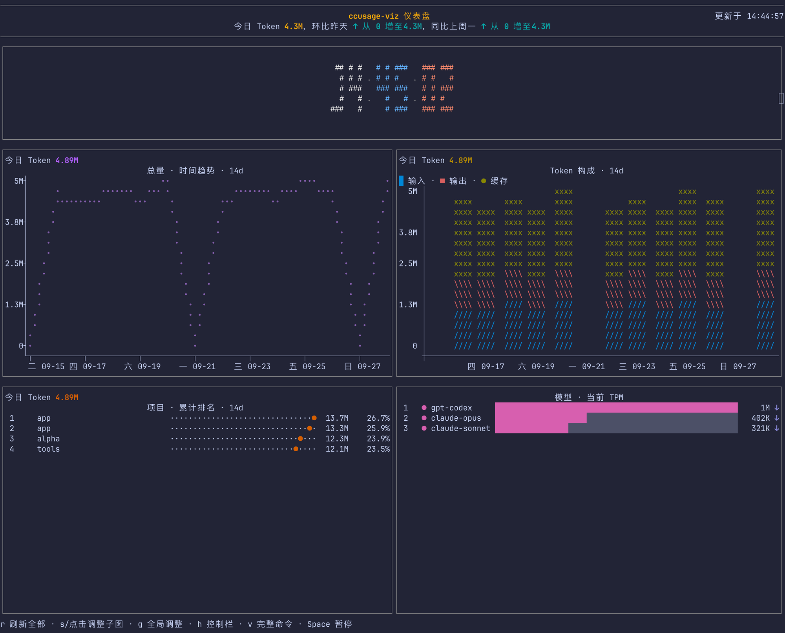 |
| 【Recommended—sidebar】 `narrow-clock` | `ccuv dashboard narrow-clock` | Digital clock and data panes in one column. | 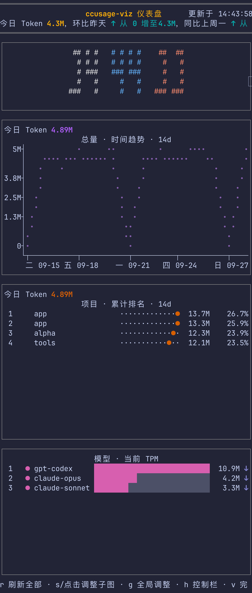 |
| `wide` | `ccuv dashboard wide` | Balanced two-column data-only overview. | 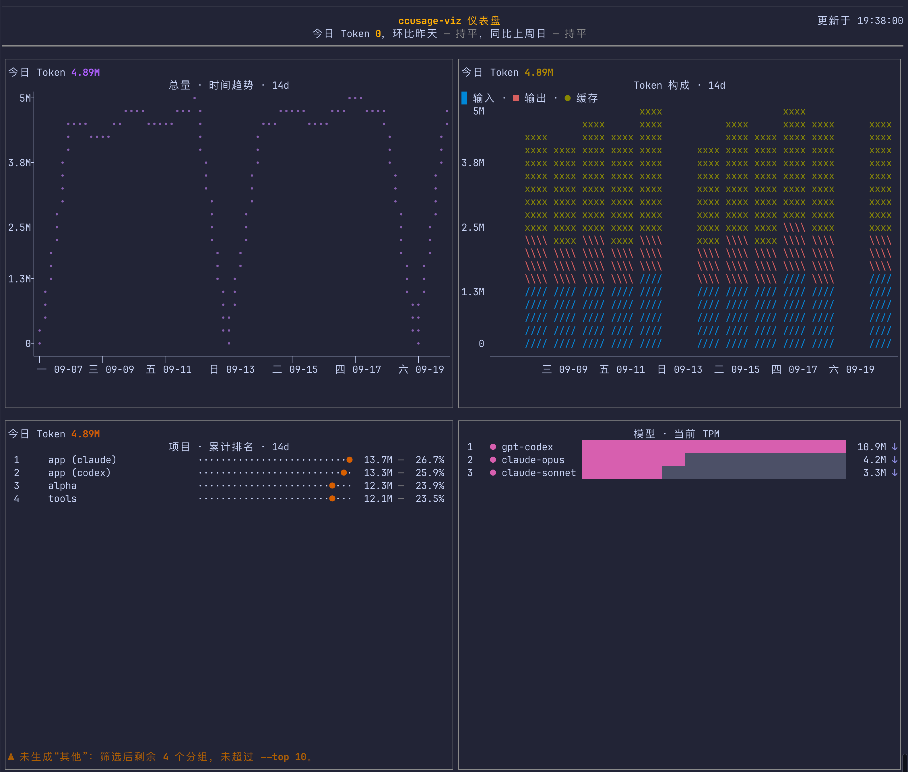 |
| `narrow` | `ccuv dashboard narrow` | Best for a compact, narrow-terminal overview. Vertical focus. | 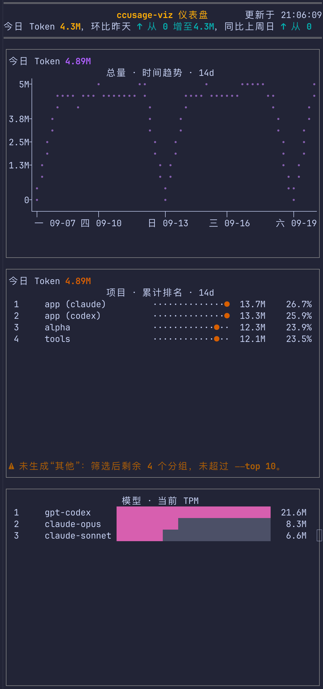 |
| `all` | `ccuv dashboard all` | Best for comparing many pane types at once. Broad gallery. | 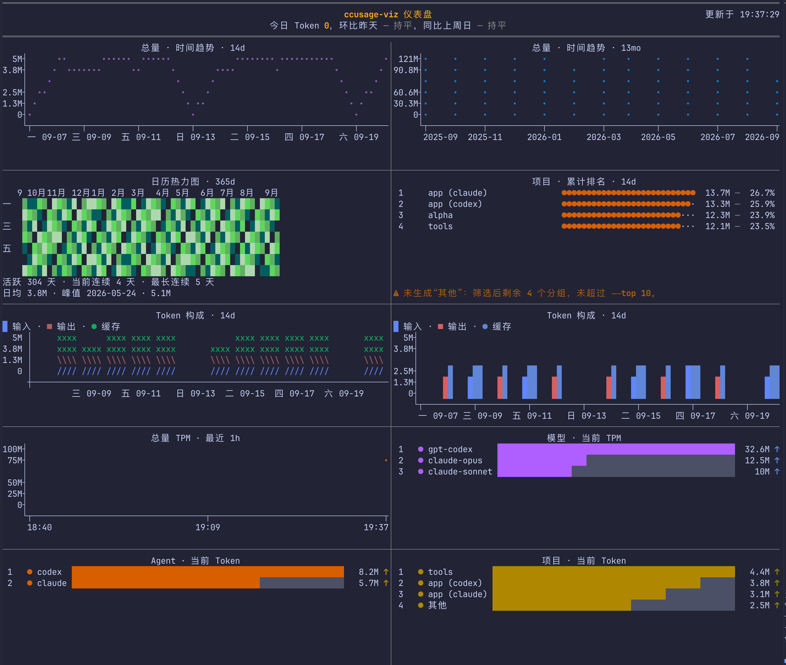 |

### Flexible Dashboard topology

Presets decide Pane content and presentation; topology independently decides where the current
ordered Panes appear. The first `--spotlight N` Panes each occupy a full-width row, and the
remaining Panes flow left-to-right into `--columns C` columns:

```bash
ccuv dashboard wide --columns 3 --spotlight 1
```

In Dashboard-global adjustment mode, press `z` to preview and edit both values. Use Up/Down or
`j`/`k` to select a field, Left/Right or `-`/`+` to adjust it, Enter to commit the whole edit,
and Escape to cancel. With a Pane selected, `{`/`}` resize its shared column and `J`/`K` resize
its row. The former `--grid`, `--layout`, `spotlight-wide`, and `spotlight-wide2` interfaces are
no longer supported.

### Your Dashboard presets

In Dashboard browse mode, press `Ctrl-S` to save the current Dashboard under a name,
or `P` to open the full-screen preset manager. The manager lists built-in and
your saved presets; use arrows or `j`/`k` to select, `Enter` to load, `s` to
save, and `x` to delete a selected user preset. Built-ins can be loaded but not
deleted. Saving a user preset with a built-in name intentionally overrides it;
deleting that user preset reveals the built-in again. Saving over an existing
user preset asks whether to overwrite or cancel.

Preset names must match `^[a-z][a-z0-9-]*$`. A saved name can be launched in a
fresh terminal with `ccuv dashboard <name>`. A named launch is closed to
configuration overrides: only `--demo`, `--lang`, `--empty`, and `--ccusage-bin`
may accompany it. For example:

```bash
ccuv dashboard weekly-review
ccuv dashboard weekly-review --demo --lang zh-CN
ccuv dashboard weekly-review --empty
ccuv dashboard weekly-review --ccusage-bin /opt/bin/ccusage
```

With a named preset, `--empty` keeps its layout, weights, display settings,
refresh/sampling cadence, timezone, demo and process settings, but replaces every
pane with an empty pane in memory; it never changes the saved preset. The ordinary
unnamed `ccuv dashboard --empty` flow remains available for composing a new
temporary Dashboard. A demo-enabled preset stays demo-enabled when loaded;
Dashboard currently has no runtime control for turning demo off.

Presets persist declarative Dashboard configuration, including language, timezone,
`ccusage-bin`, installed Dataset references, local-command argv, and executable
Overlay commands, but never query results, environments, credentials, or UI/runtime
state. An explicit `--lang` overrides the preset language. Presets are trusted
user-local automation: load only presets you trust, because loading one can run
the commands it contains. Presets live in ccuv's private state directory under
`dashboard-presets/presets.json` (`~/Library/Application Support/ccuv` on macOS,
`%LOCALAPPDATA%/ccuv` on Windows, or `${XDG_STATE_HOME:-~/.local/state}/ccuv` on
other systems). Saved presets now use schema `ccuv.dashboard-presets/v2`. Existing v1 presets
are not migrated or loaded; on the first new save, ccuv archives the original v1 file as a
private backup and starts a v2 collection. Malformed JSON and unknown schemas remain protected
from overwrite. A missing installed Dataset leaves a valid v2 preset loadable while its Pane
reports the unavailable source.

> [!TIP]
> Dashboard coordinates pane queries: identical in-flight provider requests are
> shared, avoiding duplicate work while multiple panes refresh.

## Focused chart views

`ccuv chart KIND ...` is a shortcut to a focused one-Pane Dashboard: it starts
with the requested chart, hides the Dashboard header and global summary, and
then uses the same Pane controls and lifecycle as every Dashboard. You can keep
it focused, replace the Pane, or expand it into a multi-Pane Dashboard.

| Category | View | Command | Use it for | Preview |
| --- | --- | --- | --- | --- |
| Timeline `timeline` | Timeline — 14 days | `ccuv chart timeline` | Recent daily token trends grouped by model, agent, or project. | 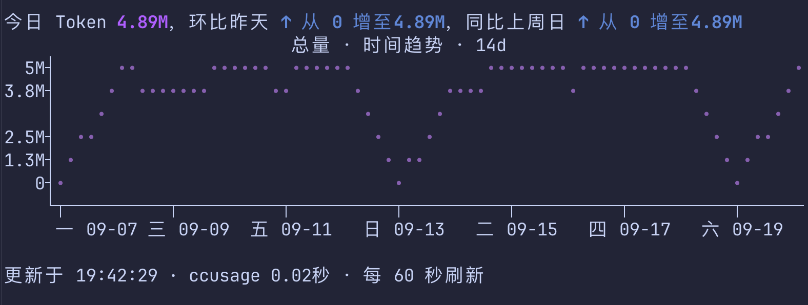 |
| Timeline `timeline` | Timeline — 13 months | `ccuv chart timeline --period 13mo` | Longer-term changes at a coarser scale. | 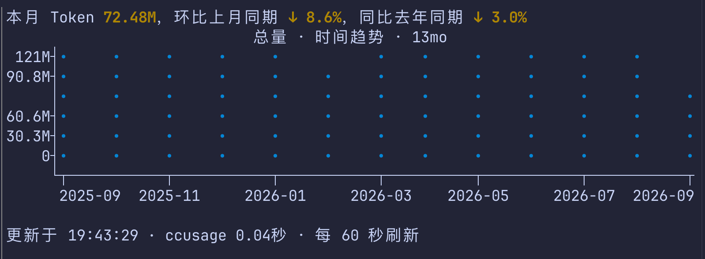 |
| Calendar `calendar` | Calendar | `ccuv chart calendar` | Active days, streaks, and concentrated usage over a longer period. | 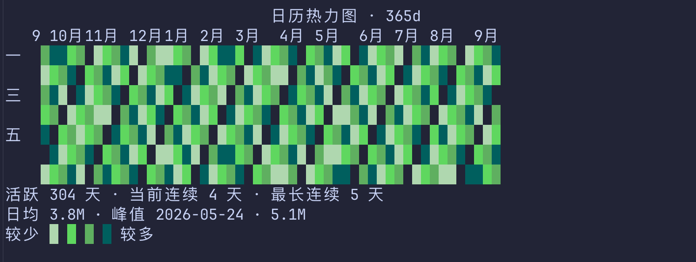 |
| Stack `stack` | Stack — composition | `ccuv chart stack` | Overall input, output, and cache-token composition over time. | 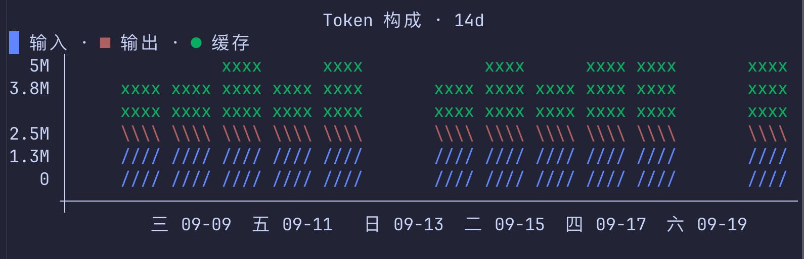 |
| Stack `stack` | Stack — cache split | `ccuv chart stack --cache split` | Cache reads versus cache creation over time. | 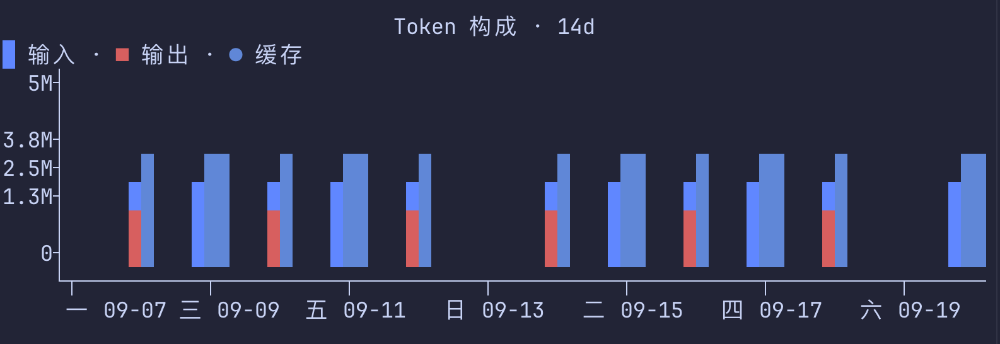 |
| Ranking `ranking` | Ranking | `ccuv chart ranking --by project` | Projects, models, or agents with the most tokens in a range. | 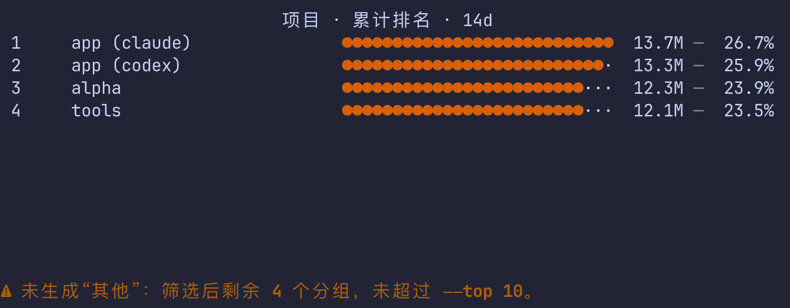 |
| Terminal animations `animate` | Animation gallery | `ccuv animate --gallery` | Provider-free presentation-only animations; optionally specify a style, for example `ccuv animate digital-clock --gallery`. `m` opens local style and theme controls. | 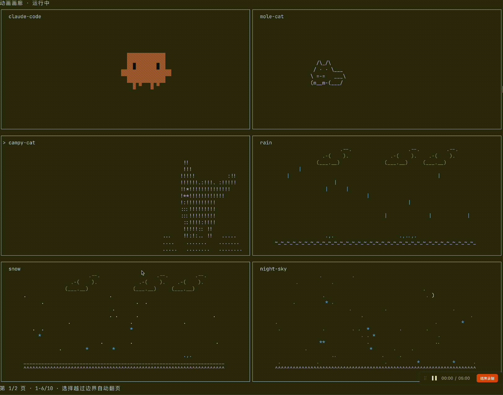 |
| Monitor `monitor` | Trend | `ccuv chart monitor` | Process-local throughput from repeated cumulative snapshots, not reconstructed hourly history. The observation begins after its sampling baseline; Timeline styles mark the invocation start while visible. | 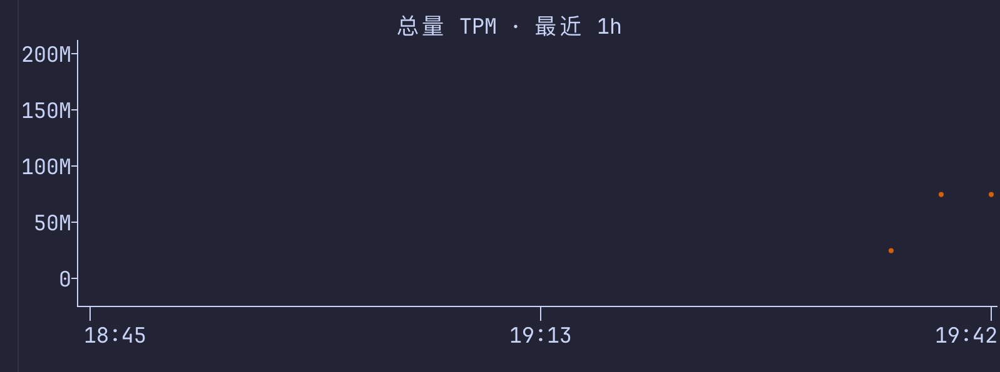 |
| Monitor `monitor` | Cumulative bars | `ccuv chart monitor --style cumulative-bars` | Retained local-day token increments. Press `w` for Today/Yesterday and `g` for hourly/half-hour buckets; unobserved periods remain distinct from observed zero values. | 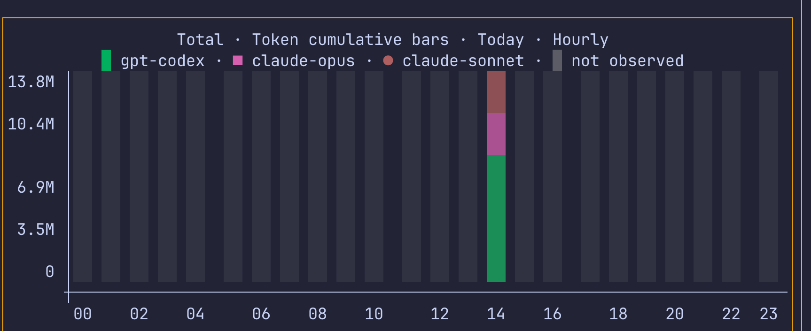 |
| Monitor `monitor` | Ranking | `ccuv chart monitor --style ranking --by project` | The selected dimension ranked within its observed window. | 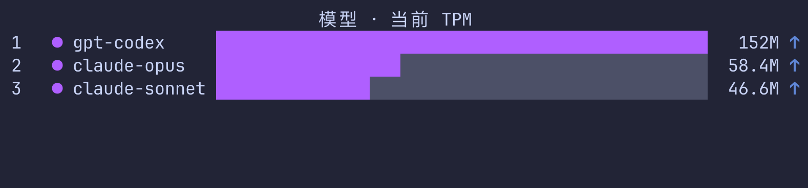 |
| Monitor `monitor` | List | `ccuv chart monitor --style list` | Process and item detail alongside the observation. |  |
| Monitor `monitor` | Animation attachment | In Monitor `ranking` or `list`: press `m`, `a`, then `s` | Animation below ranking/list data, defaulting to Mole Cat; `s`/`S` cycles eligible effects and ccuv-local `none`, while `t`/`T` changes only its theme. It waits for a comparable accepted interval and never causes another usage query. | 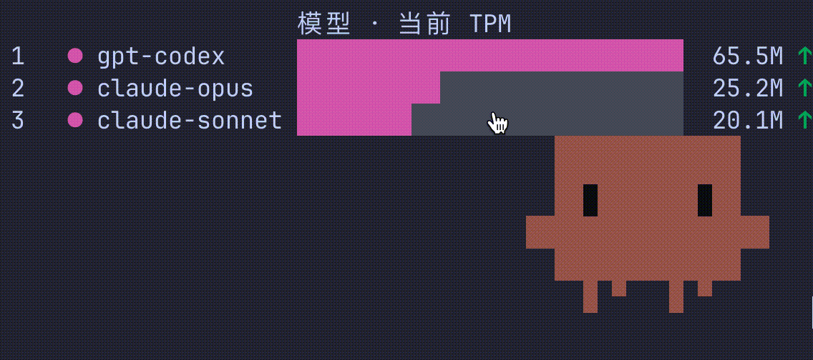 |

> [!TIP]
> Project Ranking uses conservative **Name** aggregation by default: an unambiguous
> Claude–Codex pair becomes one chart project. Press `v` for its data views: they
> show the safe source rows before aggregation, and equal non-empty `merge_group`
> values identify the rows summed into one chart project. Project views use
> conservative cross-Agent Name aggregation.

> [!TIP]
> Need several focused charts together? Add Panes from a focused chart session or
> compose a custom Dashboard and choose your own column and spotlight counts. See the
> [usage guide](docs/usage.md).

For commands, filters, controls, styles, and data semantics, see the
[usage guide](docs/usage.md). The [architecture overview](docs/architecture.md)
is intended for maintainers.

## Install, update, and remove

Requires Python 3.11–3.13. `ccuv` is the short alias for `ccusage-viz`; both
installed commands behave the same way.

### From uv

Install the isolated command-line tool:

```bash
uv tool install ccusage-viz
ccuv --version
```

Update or remove it:

```bash
uv tool upgrade ccusage-viz
uv tool uninstall ccusage-viz
```

### From pip

Use an activated virtual environment, then install or update the package:

```bash
python -m pip install --upgrade ccusage-viz
ccuv --version
```

Remove it from that environment:

```bash
python -m pip uninstall ccusage-viz
```

### From source

Clone the repository and install an editable tool:

```bash
git clone https://github.com/Cookie-HOO/ccusage-viz.git
cd ccusage-viz
uv sync --all-groups
uv tool install -e .
ccuv --help
```

After pulling newer source, refresh or remove the editable tool:

```bash
uv tool install --reinstall -e .
uv tool uninstall ccusage-viz
```

### Missing `ccusage`?

Use the backend manager:

```bash
ccuv backend        # Read-only status, executable location, and version
ccuv backend setup  # Choose, install if needed, and save your default backend
```

The setup asks whether you need DSH or WorkBuddy. Enter/unsure keeps an existing
saved choice or defaults to official; installation/configuration requires a
separate `y` confirmation. Ctrl-C or EOF cancels without changing the choice.
Official installation uses `npm install -g ccusage` and needs npm. Enhanced
installation uses a verified GitHub Release in ccuv's private tool directory,
without overwriting official ccusage or editing PATH. GitHub access is required.

When no backend exists, an interactive real-data launch offers the same setup.
With both distributions on PATH and no saved choice, interactive launches ask;
noninteractive resolution defaults to official. A missing saved backend never
silently falls back: use setup to repair or switch. Demo, empty/Dataset-only
Dashboards, help, and explicit `--ccusage-bin` runs do not trigger setup.
Noninteractive setup requires `--backend official|enhanced --yes`.

The choice is stored in `backend.json` under ccuv's private state root (the same
platform-native root as Dashboard presets). Official uses `ccusage` on the active
PATH; enhanced is saved by absolute path. Ordinary presets/copyable chart commands
follow the global selection. Custom executable paths remain pinned. For historical
preset compatibility, a saved `ccusage-bin` value of `ccusage` means follow global
selection, even if that default name was originally specified explicitly.

## Extend data sources

ccuv remains centered on Token statistics supplied by `ccusage`. When you need
additional coverage, there are two separate extension paths.

### Count DSH and WorkBuddy Tokens

Official `ccusage` remains the default. Official v20.0.46 has no dedicated DSH or
WorkBuddy adapters. To include these sources, run:

```bash
ccuv backend setup  # Answer yes to DSH / WorkBuddy
ccuv dashboard      # No --ccusage-bin needed afterward
```

This selects the unofficial [`Cookie-HOO/my-ccusage`](https://github.com/Cookie-HOO/my-ccusage)
distribution. Its upstream updates are deliberately synchronized after compatibility
verification and can lag official releases. WorkBuddy coverage includes unified
daily statistics and project/session attribution, not every focused report command.
ccuv itself contains neither collector.

Managed enhanced releases support macOS/Linux x64 and ARM64, and Windows x64.
Downloads and probes are bounded; release SHA-256 checksums detect corruption but
are not independent publisher authentication. ccuv never executes remote installer
scripts. Existing `my-ccusage` on PATH can also be reused. Updating/uninstalling
backends is not yet managed by this command; official updates use npm, and enhanced
manual releases remain available on GitHub. Explicit `--ccusage-bin PATH` is still
supported for advanced one-off overrides.

### Monitor any metric with a Dataset

Datasets add externally owned metrics—such as CI, builds, spend, bytes, reading,
or local-service activity—without changing ccusage Token collection. A Dataset
is an executable command: ccuv sends JSON requests on stdin, reads validated JSON
responses from stdout, and renders the declared Metrics in focused charts or
Dashboard Panes.

Install from the signed official catalog with `ccuv dataset` and **Browse official
datasets**, install a compatible GitHub release by entering `OWNER/REPOSITORY`,
or register a local executable:

```bash
ccuv dataset add-local /absolute/path/to/my-dataset --profile personal
ccuv dataset list
ccuv chart timeline --dataset example-activity --metric events
```

For installation, upgrades, Dashboard selection, and troubleshooting, see the
[Dataset user guide](docs/dataset-user-guide.md). Dataset authors should start
with the [Dataset developer guide](docs/dataset-developer-guide.md) and
[custom command protocol](docs/custom-command-protocol.md).

## Further reading

`ccusage-viz` is token-only and stateless: it does not analyze Agent transcripts,
store a usage database, or calculate cost, quota, QPM, or rate-limit metrics. For Codex
project attribution only, it may read the matching local session's `session_meta.cwd`; it
never stores or displays session-log content.
These documents answer the deeper questions:

| Type | Document | What it answers |
| --- | --- | --- |
| Usage | [Usage guide](docs/usage.md) | How do I install, configure, compose, and adjust charts and Dashboards? |
| Usage | [Dataset user guide](docs/dataset-user-guide.md) | How do I install, manage, select, and use local, official, or GitHub Datasets? |
| Extension development | [Custom command protocol](docs/custom-command-protocol.md) | How do I connect an additive historical dataset through a command, use empty Dashboard panes, and implement the JSON contract? |
| Extension development | [Dataset developer guide](docs/dataset-developer-guide.md) | How do I build, test locally, Probe, query, package, and publish a Dataset? |
| Project reference | [Design philosophy](docs/design-philosophy.md) | Which product boundaries, ownership rules, and presentation principles are intentional? |
| Project reference | [Architecture](docs/architecture.md) | How do CLI routes, hosts, panes, providers, processing, and renderers fit together for maintainers? |
| Project reference | [Roadmap](docs/roadmap.md) | What is planned, deferred, or open for feedback? |
| Project reference | [Known issues](docs/known-issues.md) | Which intermittent `ccusage` problems are recognized, and how can I recover safely? |

Report reproducible problems with the [bug report form](https://github.com/Cookie-HOO/ccusage-viz/issues/new?template=bug_report.yml), or propose improvements through the [feature request form](https://github.com/Cookie-HOO/ccusage-viz/issues/new?template=feature_request.yml).

Licensed under the [GNU General Public License v3.0 only](LICENSE).
